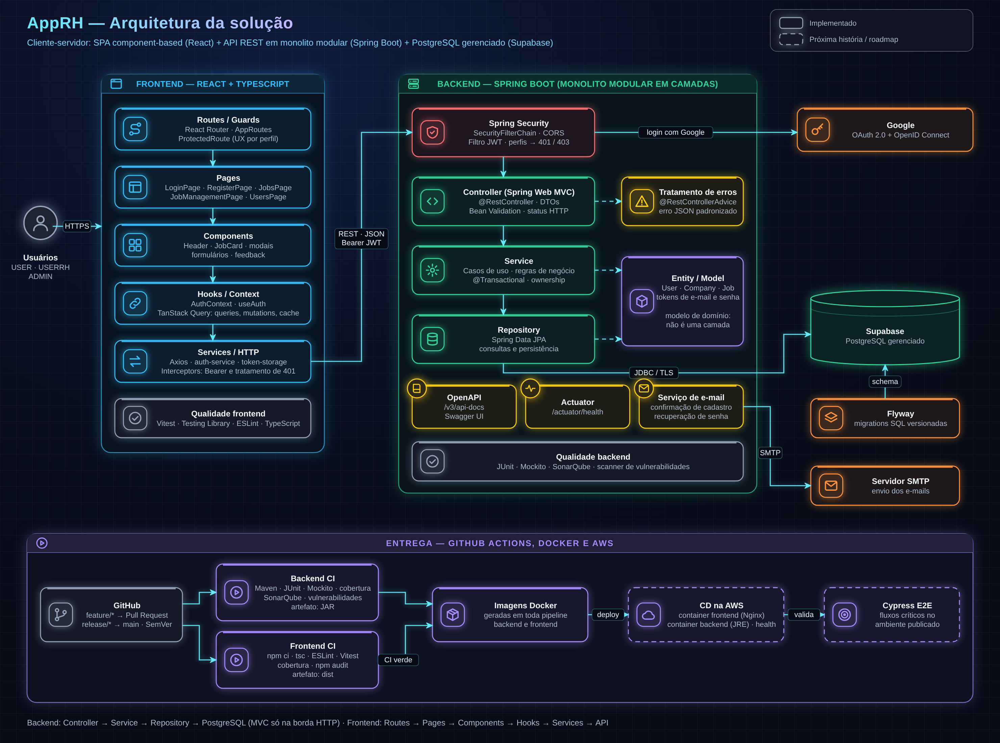

# AppRH

Plataforma web de recrutamento: candidatos consultam vagas, profissionais de RH publicam e gerenciam as vagas da sua empresa e administradores cuidam da operação. API REST em **Java/Spring Boot**, SPA em **React/TypeScript**, banco **PostgreSQL** e entrega automatizada com **GitHub Actions** e **Docker**.

## Sumário

- [Funcionalidades](#funcionalidades)
- [Perfis e permissões](#perfis-e-permissões)
- [Arquitetura](#arquitetura)
- [Stack](#stack)
- [Segurança](#segurança)
- [API](#api)
- [Qualidade e testes](#qualidade-e-testes)
- [CI/CD e Docker](#cicd-e-docker)
- [Como executar](#como-executar)
- [Estrutura do repositório](#estrutura-do-repositório)
- [Decisões arquiteturais](#decisões-arquiteturais)

## Funcionalidades

- Cadastro de candidato (USER) e de profissional de RH (USERRH), com **confirmação de e-mail**
- **Login com e-mail e senha** ou **com Google** (OAuth 2.0 + OpenID Connect)
- **Recuperação de senha por e-mail** com token de uso único
- Catálogo de vagas e de empresas
- Gestão de vagas pelo RH: criar, editar e excluir **apenas as vagas sob sua responsabilidade**
- Administração global pelo perfil ADMIN
- Documentação interativa da API com Swagger
- Health check da aplicação com Spring Boot Actuator

## Perfis e permissões

| Recurso | Público | USER | USERRH | ADMIN |
| --- | :---: | :---: | :---: | :---: |
| Cadastro, login, confirmação de e-mail, recuperação de senha | ✅ | ✅ | ✅ | ✅ |
| Catálogo de vagas | — | ✅ | ✅ | ✅ |
| Criar vaga | — | — | ✅ | ✅ |
| Editar ou excluir a própria vaga | — | — | ✅ | ✅ |
| Gerenciar qualquer vaga | — | — | — | ✅ |

A autorização é sempre validada no backend. As restrições de tela no frontend existem só para melhorar a experiência.

## Arquitetura

Aplicação cliente-servidor com três partes independentes: SPA no navegador, API REST e banco relacional gerenciado.

**Backend: monolito modular em camadas.** O Spring Web MVC atua só na borda HTTP; as regras de negócio ficam nos Services.

Requisição → Spring Security (filtro JWT) → Controller → Service → Repository → PostgreSQL

| Camada | Responsabilidade |
| --- | --- |
| Security | Filtro JWT, CORS, perfis, respostas 401 e 403 |
| Controller | Recebe HTTP, valida DTOs (Bean Validation), devolve o status |
| Service | Casos de uso, regras de negócio, transações e ownership |
| Repository | Persistência com Spring Data JPA |
| Entity | Modelo de domínio que o Service manipula e o Repository persiste |

**Frontend: SPA component-based em camadas.** Não é MVC clássico.

Routes/Guards → Pages → Components → Hooks/Context (TanStack Query) → Services (Axios) → API

Os diagramas completos ficam em [docs/arquitetura](docs/arquitetura): visão geral, backend, frontend, sequência de criação de vaga e entrega. O arquivo .drawio pode ser editado no [diagrams.net](https://app.diagrams.net).

## Stack

| Área | Tecnologias |
| --- | --- |
| Backend | Java 17, Spring Boot, Spring Web, Spring Security, Spring Data JPA, Bean Validation |
| Autenticação | JWT Bearer (stateless), OAuth 2.0 + OpenID Connect (Google) |
| Banco | PostgreSQL (Supabase), Flyway |
| Frontend | React, TypeScript, Vite, React Router, Axios, TanStack Query, Context API |
| Documentação | OpenAPI / Swagger UI |
| Testes | JUnit, Mockito, Vitest, Testing Library |
| Qualidade | SonarQube, ESLint, TypeScript |
| Entrega | GitHub Actions, Docker |
| Operação | Spring Boot Actuator |

## Segurança

- **Sessão stateless com JWT:** o token carrega sub, role e exp, e é validado em toda requisição.
- **Autorização em duas camadas:** perfil na SecurityFilterChain e ownership no Service, para que um RH nunca altere a vaga de outro.
- **Login com Google via OpenID Connect:** o backend valida o ID token e emite o mesmo JWT da aplicação, então perfis e regras não mudam.
- **E-mail confirmado** antes do primeiro acesso.
- **Recuperação de senha** com token aleatório de uso único, expiração curta e só o hash salvo no banco.
- **Segredos fora do código:** banco, chave JWT, SMTP e credenciais OAuth vêm de variáveis de ambiente ou GitHub Secrets.
- **Auditoria de dependências** em toda pipeline.

## API

Com a aplicação rodando:

| Recurso | URL |
| --- | --- |
| Swagger UI | http://localhost:8080/swagger-ui/index.html |
| Contrato OpenAPI (JSON) | http://localhost:8080/v3/api-docs |
| Contrato OpenAPI (YAML) | http://localhost:8080/v3/api-docs.yaml |
| Health check | http://localhost:8080/actuator/health |

Principais grupos de endpoints:

| Grupo | Exemplos                                                        |
| --- |-----------------------------------------------------------------|
| Autenticação | POST /auth/login, POST /auth/register, POST /auth/email/confirm |
| Empresas | GET /api/companies, GET /api/rh/company                         |
| Vagas | GET /api/jobs                                                   |
| Gestão de vagas | GET, POST, PUT e DELETE em /api/management/jobs                 |

Os erros seguem um formato JSON padrão com status, message, path, timestamp e errors.

## Qualidade e testes

- **Backend:** testes unitários com JUnit e Mockito nos Services, Controllers e regras de segurança.
- **Frontend:** Vitest e Testing Library em hooks, services, contexto, páginas e componentes.
- **Análise estática:** SonarQube no backend; ESLint e checagem de tipos do TypeScript no frontend.
- **Cobertura** medida na CI, com limites mínimos que sobem aos poucos.

## CI/CD e Docker

Fluxo de branches: feature/* → Pull Request → release/* → main, com tag SemVer. Merge só com todos os checks verdes.

| Etapa | Backend | Frontend |
| --- | --- | --- |
| Verificação | Compile | tsc --noEmit, ESLint |
| Testes | JUnit + Mockito, cobertura | Vitest, cobertura |
| Qualidade e segurança | SonarQube, scanner de vulnerabilidades | npm audit |
| Artefato | JAR | dist |
| Imagem | Docker | Docker |

Toda pipeline aprovada gera a imagem Docker da aplicação. O próximo passo é publicar as imagens num registry e automatizar o deploy na AWS (veja o [Roadmap](#roadmap)).

## Como executar

<!-- Ajuste nomes de variáveis, portas e caminhos para os do seu projeto -->

**Pré-requisitos:** Java 17, Node.js, Docker e um banco PostgreSQL (local ou Supabase).

**1. Variáveis de ambiente do backend**

bash
DB_URL=jdbc:postgresql://localhost:5432/apprh
DB_USERNAME=...
DB_PASSWORD=...
JWT_SECRET=...
MAIL_HOST=...
MAIL_USERNAME=...
MAIL_PASSWORD=...
GOOGLE_CLIENT_ID=...
GOOGLE_CLIENT_SECRET=...

Nunca versione esses valores. O `GOOGLE_CLIENT_SECRET` fica só no backend.

**2. Backend**

bash
cd AppRH
./mvnw spring-boot:run

As migrations do Flyway rodam automaticamente na subida.

**3. Frontend**

bash
cd AppRH_fs
npm ci
npm run dev

**4. Testes**

bash
cd AppRH && ./mvnw test
cd AppRH_fs && npm run test:coverage

**5. Com Docker**

bash
docker build -t apprh-backend ./backend
docker build -t apprh-frontend ./frontend

## Estrutura do repositório

.github/workflows/      pipelines de backend e frontend
backend/                API Spring Boot
src/main/java/...     config, security, controller, dto, service, repository, entity, exception
src/main/resources/db/migration   migrations Flyway
frontend/               SPA React + TypeScript
src/                  routes, pages, components, hooks, contexts, services, interfaces, utils
docs/
arquitetura/          diagramas (.drawio e .png)
adr/                  registros de decisões arquiteturais

## Decisões arquiteturais

As principais decisões estão registradas como ADRs (Architecture Decision Records) em [docs/adr](docs/adr):

1. Monolito modular em camadas
2. Autenticação stateless com JWT e autorização por perfil e ownership
3. Login com Google via OpenID Connect emitindo o JWT da aplicação
4. Schema versionado com Flyway
5. Imagem Docker gerada na pipeline

## Autor

**Felipe Pena** · [LinkedIn](https://www.linkedin.com/in/felipe-pena-8a31621a6)

**Felipe Pena** .  [Github] (https://github.com/felipee-pena)

**Felipe Pena** . [E-mail] (fehdacp@gmail.com)

Projeto pessoal de estudo, desenvolvido para aplicar na prática padrões de mercado de arquitetura, segurança e engenharia de software.
